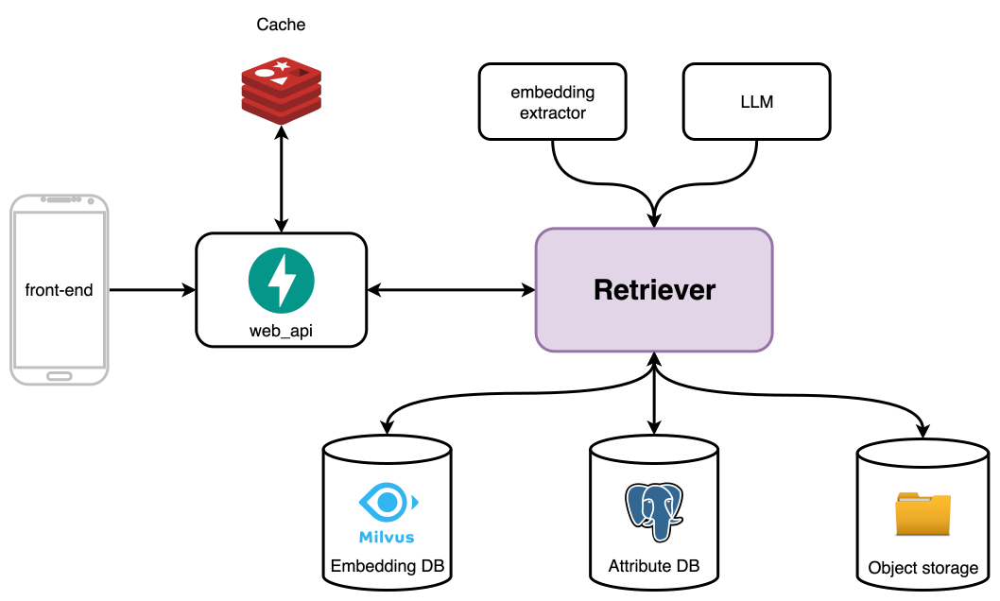

<p style="text-align: center;font-size: 35px;font-weight: 900">Visual retriever</p>


</img>

# System design

version: v1.1

# Features and requirements

1. Upload resource
1. Search image given the patch of image (both in raw image and information of bounding box)
1. Search image given the information of image/video already in the database
1. Integrate with Object Store

# Description

Embedding extractor:

- Extract image embedding
- Extract keyword embedding

LLM:

- Extract keywords in specified categories

Attribute DB:

- Store image metadata

Embedding DB:

- Store image embedding
- Store word embedding
- Search similar images given embedding
- Search similar keywords given embedding

# Scaling plan

### 1. When auto-complete traffic is suddenly high

If only auto-complete request is high, that affects:

- web-api instance: websocket connection
- kv cache: read-only operation

Strategy:
For KV cache: scale out with primary node for writing and multiple secondary node for faster reading
For web server: initially, try scale up and observe metrics like Error rate of request. If this rate is increasing, that means the resource is reaching its limit -> switch to horizontal scaling.

### 2. When traffic of image insertion increases

Affected components: every componnents (mixture of CPU-bound and IO-bound)

Solution:

- Break into services.
- With `keyword-extraction` and `embd-extraction` we can start scaling up and scaling out if waiting time of each image increase.
- With `Embedding DB`, as Milvus is AP system but in this scenario, we are prioritizing consistency, so we need to put a _queue_ in front of the Milvus or maybe create a _RabbitMQ instance_ to communicating of entire system. RabbitMQ will now plays the role as a queue storing pending requests.
- For `Object storage`, since now this is IO-bound task, we can for each file create a coroutine and start sending file to DFS.
- For `Attribute DB`, since write requests are high in number, naive replication isn't helpful since it only improve read traffic. Sharding therefore is needed.

If

### 3. When traffic of Retrieving with keywords increases

Affected components: web-api and Attribute DB
request type: purely IO-bound

Solution:
For `web-api`, may do:

- vertical scaling: add more CPUs and adjust no. workers to higher
- horizontal scaling: should be done when performance metric starts reaching limit,

For `Attribute DB`, may:

- duplicate to many replicas (this will increase read performance)

May add Cache in the middle.

1. Naive caching strategy: For each query, says `"tall","handsome"`, store the results in the cache

```json
{
  "tall": [{ "resource_id": "3bedca", "score": 12 }]
}
```

pros:

- simple

cons:

- very low hit rate: Mathematically, if there are $n$ keywords in the database, then the probability of that combo of querying keywords to appear is: $\dfrac{1}{C_n^2}$

2. Time-aware graph-based caching:

Imagine a cache is like a heterogenerous graph: 2 types of node: one represents _keywords_ and another presents _resources_.

Target now can be formulated as follow: Given list of _keywords_, find `k` common adjacent _resource nodes_ in graph. If cannot find enough `k`, start retrieving in Attribute database and cache them.

To avoid one image is kept sending to client, each resource node has **_stale duration_**.

```json
{
    "tall": [
        { "resource_id": "3bedca", "stale_duration_sec": 30 * 60, "dt_added": "2025-11-21T10:00:00" },
        { "resource_id": "ced865", "stale_duration_sec": 30 * 60, "dt_added": "2025-11-20T12:11:20" },
    ]
}
```

Pros:

- increase hit rate because 1) the increasing speed of keyword quantity is slower than the increasing speed of image and 2) one image usually have at least 4, 5 corresponding keywords

Cons:

- complex

### 3. When traffic of Retrieving with full sentence increases

Affected components: nearly every component
request type: mix:

- IO-bound: accessing Attribute DB and Embedding DB, purely read
- CPU-bound: `keyword-extraction` and `embedding-extraction`

Not necessary to guarantee consistency as _Inserting images_

Solution:

- For `web-api`: Scale up then scale out when metrics reach limit
- For `keyword-extraction` and `embedding-extraction`: Scale up (i.e. add more GPU capacity), then scale out when metrics reach limit
- For `Embedding DB`: Configure multiple replicas to scale out
- For `Attribute DB`: Apply strategy as previous section (i.e. scale out and maybe caching)

### 4. When traffic of multiple query types increases

Apply combination of solution
